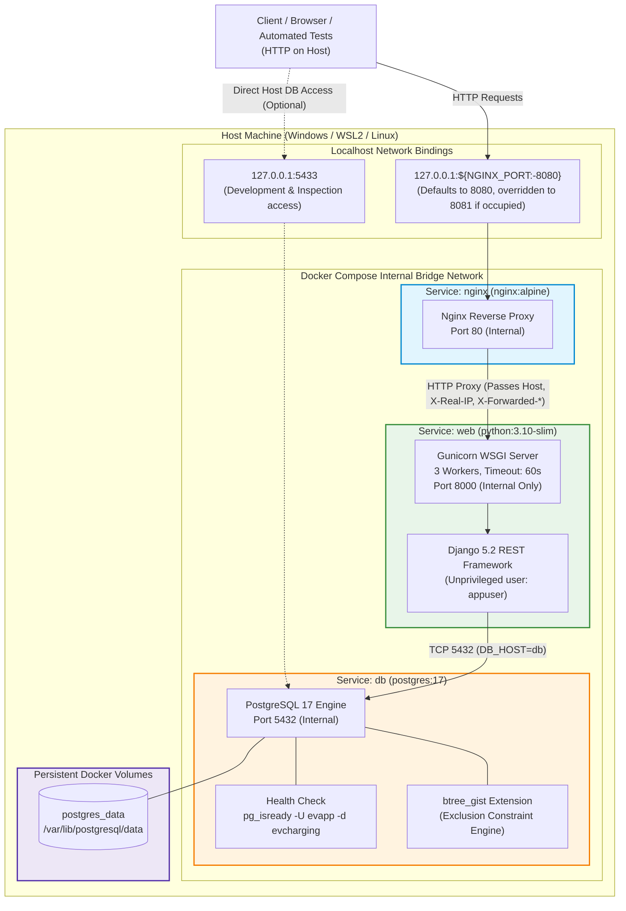

# System Deployment Architecture

---

## 1. Overview and Scope

This document details the deployment architecture for the **EV Charging Slot Booking System**. The system is composed of three containerized services running under Docker Compose:
1. **Nginx** (Edge reverse proxy / Web server)
2. **Web** (Django 5.2 / Django REST Framework application served via Gunicorn)
3. **Database** (PostgreSQL 17 with `btree_gist` extension)

> [!IMPORTANT]
> **Local Deployment Note**: This setup is a **local HTTP development and staging architecture**. It binds services strictly to `127.0.0.1` and does not configure TLS/HTTPS certificates or external DNS routing. Production deployment would require an SSL termination proxy (e.g. Let's Encrypt / AWS ALB) in front of Nginx.

---

## 2. Architecture Diagram

The diagram below illustrates the actual container topology, network boundaries, published host ports, and persistent volume storage.

---

## 3. Component Responsibilities

### 3.1 Nginx Service (`nginx`)
- **Image**: `nginx:alpine`
- **Host Binding**: `127.0.0.1:${NGINX_PORT:-8080}:80`
- **Configuration**: Mounted from `./nginx/default.conf` read-only.
- **Responsibilities**:
  - Serves as the single public entry point for all API and health check traffic.
  - Proxies traffic internally to `http://django_app` (`web:8000`).
  - Forwards standard reverse-proxy headers:
    - `Host $host` (ensuring Django `ALLOWED_HOSTS` matches `localhost` or `127.0.0.1`).
    - `X-Real-IP $remote_addr`
    - `X-Forwarded-For $proxy_add_x_forwarded_for`
    - `X-Forwarded-Proto $scheme`
  - Sets request body limit (`client_max_body_size 10M`).

### 3.2 Django / Gunicorn Service (`web`)
- **Image**: Built locally from [Dockerfile](file:///c:/DevOps_Project/Dockerfile) (`python:3.10-slim`).
- **Security**: Runs under unprivileged user `appuser:appgroup`.
- **WSGI Server**: Gunicorn 23.0.0 with 3 worker processes on `0.0.0.0:8000`.
- **Port Exposure**: Internal Compose network only (no host port mapped).
- **Startup Dependency**: Depends on `db` with `condition: service_healthy`. Gunicorn starts only after PostgreSQL is fully ready to accept connections.
- **Responsibilities**:
  - Validates API request payloads via Django REST Framework serializers.
  - Enforces TokenAuthentication on protected endpoints.
  - Executes database transactions (`transaction.atomic()`).

### 3.3 PostgreSQL Service (`db`)
- **Image**: `postgres:17`
- **Internal Port**: `5432`
- **Host Port**: `127.0.0.1:5433:5432` (mapped for host development and debugging).
- **Healthcheck**: `pg_isready -U ${POSTGRES_USER} -d ${POSTGRES_DB}` every 5s, 10 retries.
- **Data Persistence**: Backed by named volume `postgres_data` mapped to `/var/lib/postgresql/data`.
- **Responsibilities**:
  - Enforces relational schemas and constraints.
  - Provides PostgreSQL `btree_gist` index support for `TSTZRANGE` overlap detection.

---

## 4. End-to-End Request Flows

### 4.1 Unauthenticated Discovery Request (`GET /api/stations/`)
1. Client issues `GET /api/stations/` to `http://127.0.0.1:8081`.
2. Nginx receives request on port 80 and passes it to upstream `django_app` (`web:8000`).
3. Gunicorn worker dispatches request to Django WSGI handler.
4. Django executes `StationListView`, querying active stations (`is_active=True`).
5. Response serialized to JSON and returned through Nginx to client with HTTP 200 OK.

### 4.2 Authenticated Booking Creation (`POST /api/bookings/`)
1. Client sends `POST /api/bookings/` with `Authorization: Token <token>` and JSON payload (`charger`, `vehicle`, `start_time`, `end_time`).
2. Nginx forwards headers and payload to Gunicorn.
3. Django DRF authenticates user via `TokenAuthentication`.
4. `BookingCreateSerializer` validates:
   - Vehicle ownership matches authenticated user.
   - Slot duration is exactly 30 minutes.
   - Start time is in the future.
   - Charger and station are active, and charger status is not OFFLINE or MAINTENANCE.
5. In `BookingListCreateView.create`:
   - Opens `transaction.atomic()`.
   - Acquires row-level lock on `Charger` (`Charger.objects.select_for_update().get(...)`).
   - Runs application pre-check for existing active bookings.
   - Calls `Booking.objects.create(...)`.
6. PostgreSQL validates `booking_end_after_start` check constraint and `no_overlapping_active_charger_bookings` exclusion constraint.
7. If concurrent transaction committed an overlapping slot first, PostgreSQL triggers constraint violation:
   - Diagnostic constraint name is matched (`no_overlapping_active_charger_bookings`).
   - Django catches `IntegrityError` outside atomic block and returns HTTP 409 Conflict.
8. If clean, returns HTTP 201 Created with serialized booking representation.

---

## 5. Security & Isolation Summary

- **Host Boundary**: Neither Gunicorn nor PostgreSQL is exposed on wildcard `0.0.0.0`. PostgreSQL binds only to host `127.0.0.1:5433`, and Nginx binds only to `127.0.0.1:${NGINX_PORT:-8080}`.
- **Least Privilege**: The web container executes without root capabilities under `appuser`.
- **Secret Isolation**: Django `SECRET_KEY` and PostgreSQL credentials are never baked into Docker images. Docker Compose mandates `${SECRET_KEY:?Set SECRET_KEY in .env}`.
- **Production Hardening Default**: Compose enforces `DEBUG: ${DEBUG:-0}` by default.
